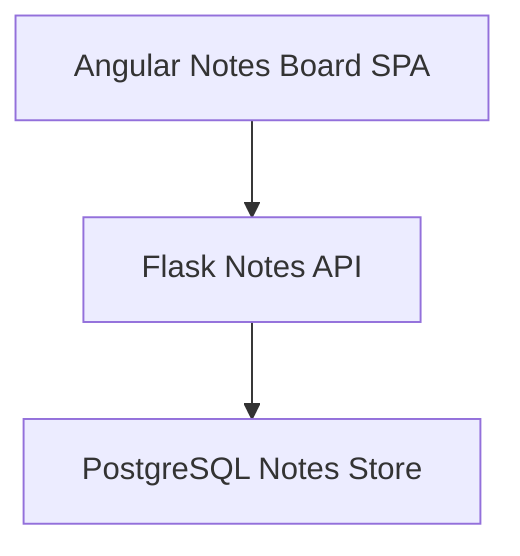
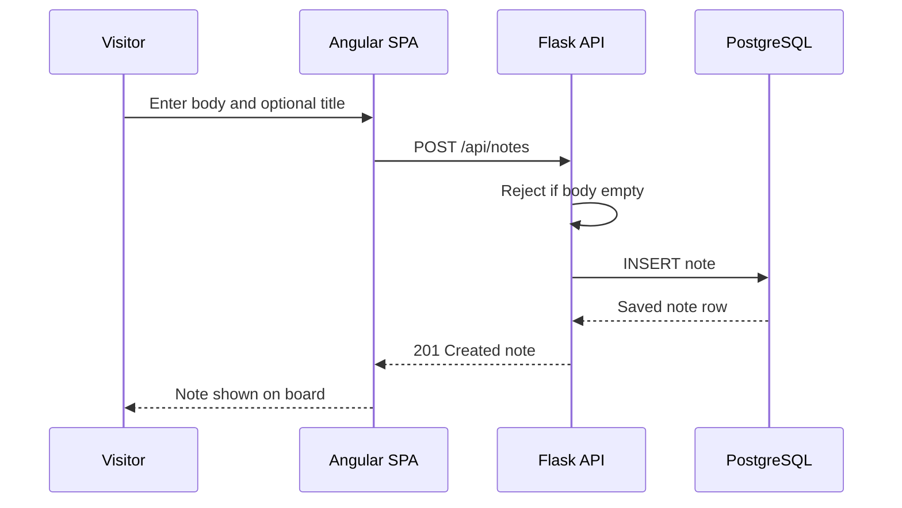
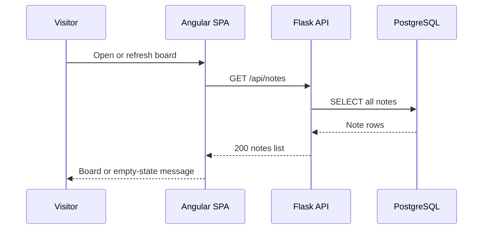
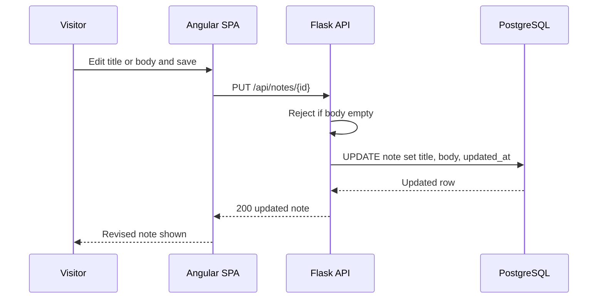
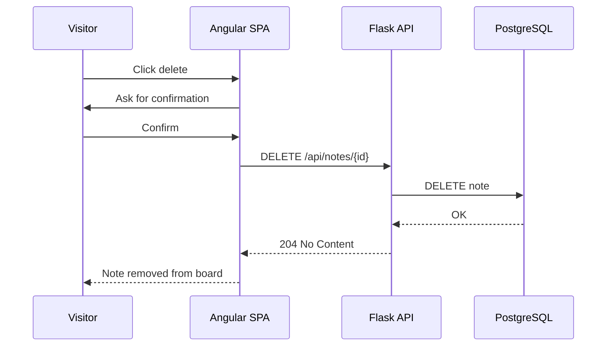
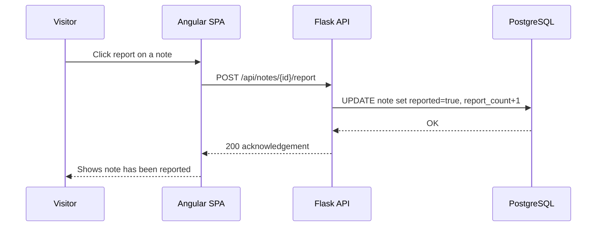
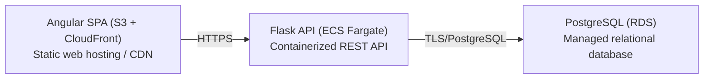

# Architecture

> Maintained by QuorQ AI SDLC. Text between `sdlc:auto` markers is regenerated; anything outside them is yours and is kept.

<!-- sdlc:auto:start narrative -->
## Overview

### ARCH-001 · approved · source: architecture:summary

Overall architecture is an open-access, no-login shared notes board: Angular SPA + Flask REST API + PostgreSQL, hosted entirely in AWS Mumbai (ap-south-1) for data residency.

Approved, version 1. Any visitor can create, read, edit and delete any note wiki-style, report objectionable notes, and reach grievance/contact info, aligning with IT (Intermediary) Rules 2021. No accounts or personal-data collection means DPDP consent machinery does not apply. Updates are visible on page refresh, not live sync, matching the modest-audience, lightweight scope.

**Related:** US-011

### ARCH-002 · approved · source: architecture:component:web_spa

Angular 22 SPA renders the single shared notes board with create/edit/delete, report, delete-confirmation, and empty-state UI.

The Angular Notes Board SPA provides: create/edit/delete forms with validation, a report action with acknowledgement, a delete confirmation step, an empty-state message when no notes exist, and surfaced grievance/contact information. Data is reloaded on page refresh rather than via live sync.

**Related:** US-001, US-002, US-003, US-004, US-005, US-009

- ⚠ Specific US-xxx mapping for each SPA capability is not explicitly given in the input; mapping above is inferred from feature description, not stated directly.

### ARCH-003 · approved · source: architecture:component:api_backend

Flask 3.0 REST API exposes public CRUD, report, and grievance-contact endpoints with no authentication layer.

The Flask Notes API lists, creates, edits, deletes and reports notes; enforces plain-text-only storage and non-empty body validation; strips formatting/attachments; and writes access/ICT logs. There is explicitly no authentication layer, consistent with the no-login design.

**Related:** US-003, US-004, US-005, US-009

### ARCH-004 · approved · source: architecture:component:notes_db

PostgreSQL 16 stores a single shared notes table hosted in India, supporting wiki-style edits to any row.

The Notes Store holds one table with title, body, timestamps, and reported flag for the full shared set of notes. Hosted in India to satisfy data residency, and any row can be edited or deleted by any visitor (wiki-style), with no version history retained.

**Related:** US-011

### ARCH-005 · approved · source: architecture:critical_path:create_note

Create-note flow: visitor submits body text and optional title; API rejects empty bodies and stores plain text only.

Visitor submits body text and optional title. API rejects empty body (AC-006), stores only plain text and optional title (AC-007), and returns the saved note, which then appears on the shared board.

**Related:** US-003

- ⚠ AC-006 and AC-007 are not mapped to a specific US-xxx key in the provided input.

### ARCH-006 · approved · source: architecture:critical_path:read_all_notes

Read flow: on load or refresh, the SPA fetches all notes and displays them, or shows an empty-state message if none exist.

On load or refresh the SPA fetches all notes and shows each title and body, or an empty-state message when none exist (AC-008, AC-009, AC-015).

**Related:** US-001, US-002

- ⚠ AC-008/AC-009/AC-015 not mapped to specific US-xxx keys in the provided input.

### ARCH-007 · approved · source: architecture:critical_path:edit_note

Edit flow: any visitor can edit any note wiki-style; empty body saves are blocked; no version history is kept.

Any visitor edits any note. API blocks saving an empty body (AC-011), overwrites the row with no version history (AC-012, NFR-006), and the revision is shown to all visitors on refresh.

**Related:** US-004

- ⚠ AC-011, AC-012 and NFR-006 are not mapped to a specific US-xxx key in the provided input.

### ARCH-008 · approved · source: architecture:critical_path:delete_note

Delete flow: a visitor or operator deletes any note after confirmation; deletion is permanent and visible to everyone.

A visitor or operator deletes any note after a confirmation step (AC-014). The row is permanently removed and the note disappears for everyone, serving both wiki-style delete and removal of reported content (AC-013, AC-020).

**Related:** US-005, US-009

- ⚠ AC-013, AC-014, AC-020 are not mapped to a specific US-xxx key in the provided input.
- ⚠ Input distinguishes 'visitor or operator' for deletion but no operator/role concept is defined elsewhere in the architecture (system has no authentication layer) -- flagged as a possible discrepancy worth confirming.

### ARCH-009 · approved · source: architecture:critical_path:report_note

Report flow: a visitor flags an objectionable note with no login or personal data required; the API records the report and acknowledges it.

A visitor reports a note with no login or personal data (AC-017, AC-018). The API records the report by setting the reported flag and incrementing a counter, then acknowledges the report, supporting IT (Intermediary) Rules 2021 alignment (NFR-003).

**Related:** US-009

- ⚠ AC-017, AC-018, NFR-003 are not mapped to a specific US-xxx key in the provided input.

### ARCH-010 · approved · source: architecture:entities:notes

Single 'notes' entity holds id, title, body, reported flag, report count, and timestamps.

Entity 'notes' fields: id, title, body, reported, report_count, created_at, updated_at. This single table backs all CRUD and report operations with no separate audit/version table.

**Related:** US-003, US-004, US-005, US-009

### ARCH-011 · approved · source: architecture:endpoints

Six REST endpoints cover listing, creating, editing, deleting, reporting notes, and retrieving grievance/contact info.

GET /api/notes - list all notes, empty array when none exist. POST /api/notes - create a note, body required, title optional, plain text only. PUT /api/notes/{id} - edit any note wiki-style, body required, no version history. DELETE /api/notes/{id} - permanently delete any note, also used to remove reported notes. POST /api/notes/{id}/report - report a note, sets reported flag, no personal data required. GET /api/grievance-contact - returns grievance/contact info for IT (Intermediary) Rules 2021 compliance.

**Related:** US-001, US-003, US-004, US-005, US-009

### ARCH-012 · approved · source: architecture:deployment_nodes

Deployment is fully AWS-hosted in Mumbai: Angular SPA on S3+CloudFront, Flask API on ECS Fargate, PostgreSQL on RDS.

Angular SPA (S3 + CloudFront): static web hosting/CDN for Angular 22 build artifacts. Flask API (ECS Fargate): containerized REST API running Python 3.12 / Flask 3.0 under gunicorn. PostgreSQL (RDS): managed PostgreSQL 16 database. All nodes located in ap-south-1 (Mumbai) for data residency.

**Related:** US-011

### ARCH-013 · approved · source: architecture:technology_decisions

Approved stack: Angular 22, Flask 3.0, PostgreSQL 16, AWS (ap-south-1), each chosen over named alternatives for fit and data residency.

Frontend: Angular 22 (alternatives considered: React, Vue) -- renders the single shared board, forms, confirmation, empty-state, and report action in one SPA. Backend: Flask 3.0 (alternatives: FastAPI, Django) -- thin REST API fits one notes table plus report/grievance endpoints, no auth layer. Database: PostgreSQL 16 (alternatives: MySQL, SQLite) -- reliably stores the shared notes table and supports wiki-style edits; hosted on RDS in Mumbai for residency. Cloud: AWS (alternatives: Azure, GCP) -- ap-south-1 keeps app and data in India (US-011) and handles the modest concurrent audience via S3/CloudFront, Fargate and RDS.

**Related:** US-011
<!-- sdlc:auto:end narrative -->

<!-- sdlc:auto:start building-blocks -->
## Building Block View

| ID | Name | Technology | Responsibility | Depends on |
|---|---|---|---|---|
| web_spa | Angular Notes Board SPA | Angular 22 | Renders the single shared board, provides create/edit/delete forms with validation, a report action with acknowledgement, a delete confirmation step, an empty-state message, and surfaces grievance/contact information. Reloads data on page refresh. | api_backend |
| api_backend | Flask Notes API | Flask 3.0 | Exposes a public REST API for listing, creating, editing, deleting and reporting notes, enforces plain-text-only storage and non-empty body validation, strips formatting/attachments, and writes access/ICT logs. No authentication layer. | notes_db |
| notes_db | PostgreSQL Notes Store | PostgreSQL 16 | Stores the single shared set of notes (title, body, timestamps, reported flag) in one table hosted in India, supporting wiki-style edits to any row. | — |

<!-- sdlc:auto:end building-blocks -->

<!-- sdlc:auto:start runtime -->
## Runtime View

### Create a note

Visitor submits body text and optional title. The API rejects empty body (AC-006), stores only plain text and optional title (AC-007), and returns the saved note which appears on the shared board.

- **Components:** web_spa, api_backend, notes_db
- **Modules:** notes_form.component, notes.service (Angular), routes/notes.py, models/note.py
- **Key functions:** createNote(title, body), validate_body(body), insert_note(title, body)

### Read all notes

On load or refresh the SPA fetches all notes and shows each title and body, or an empty-state message when none exist (AC-008, AC-009, AC-015).

- **Components:** web_spa, api_backend, notes_db
- **Modules:** board.component, notes.service (Angular), routes/notes.py
- **Key functions:** loadNotes(), list_notes()

### Edit any note (wiki-style)

Any visitor edits any note. API blocks saving an empty body (AC-011), overwrites the row with no version history (AC-012, NFR-006), and the revision is shown to all on refresh.

- **Components:** web_spa, api_backend, notes_db
- **Modules:** note_edit.component, notes.service (Angular), routes/notes.py, models/note.py
- **Key functions:** updateNote(id, title, body), validate_body(body), update_note(id, title, body)

### Delete or remove a note

A visitor or operator deletes any note after a confirmation step (AC-014). The row is permanently removed and the note disappears for everyone, serving both wiki-style delete and removal of reported content (AC-013, AC-020).

- **Components:** web_spa, api_backend, notes_db
- **Modules:** delete_confirm.component, notes.service (Angular), routes/notes.py
- **Key functions:** confirmDelete(id), deleteNote(id), delete_note(id)

### Report an objectionable note

A visitor reports a note with no login or personal data (AC-017, AC-018). The API records the report by setting the reported flag and incrementing a counter, then acknowledges, supporting IT (Intermediary) Rules 2021 alignment (NFR-003).

- **Components:** web_spa, api_backend, notes_db
- **Modules:** report_action.component, notes.service (Angular), routes/notes.py
- **Key functions:** reportNote(id), flag_note(id)

<!-- sdlc:auto:end runtime -->

<!-- sdlc:auto:start deployment-view -->
## Deployment View

| Name | Service | Runtime | Scaling | Environment |
|---|---|---|---|---|
| Angular SPA (S3 + CloudFront) | Static web hosting / CDN | Angular 22 build artifacts | CDN edge cache, auto | dev |
| Flask API (ECS Fargate) | Containerized REST API | Python 3.12 / Flask 3.0 under gunicorn | 1-2 tasks, modest audience | dev |
| PostgreSQL (RDS) | Managed relational database | PostgreSQL 16 | single instance (modest load) | dev |

| Source | Target | Protocol |
|---|---|---|
| Angular SPA (S3 + CloudFront) | Flask API (ECS Fargate) | HTTPS |
| Flask API (ECS Fargate) | PostgreSQL (RDS) | TLS/PostgreSQL |

<!-- sdlc:auto:end deployment-view -->

<!-- sdlc:auto:start decisions -->
## Architecture Decisions

| Layer | Choice | ADR |
|---|---|---|
| Frontend | Angular 22 | [ADR-0001](adr/frontend.md) |
| Backend | Flask 3.0 | [ADR-0002](adr/backend.md) |
| Database | PostgreSQL 16 | [ADR-0003](adr/database.md) |
| Cloud | AWS | [ADR-0004](adr/cloud.md) |
<!-- sdlc:auto:end decisions -->

<!-- sdlc:auto:start links -->
## Related Documents

- [Data Model](data-model.md)
- [API Specification](api/openapi.yaml)
- [Architecture Decision Records](adr/README.md)
<!-- sdlc:auto:end links -->
