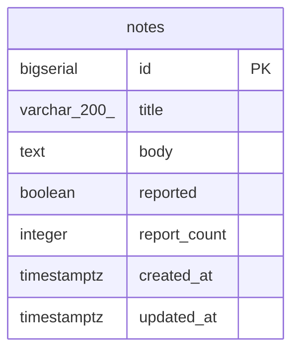

# Data Model

<!-- sdlc:auto:start entities -->
### notes

| Field | Type | PK | FK | Nullable |
|---|---|---|---|---|
| id | bigserial | True | — | False |
| title | varchar(200) | False | — | True |
| body | text | False | — | False |
| reported | boolean | False | — | False |
| report_count | integer | False | — | False |
| created_at | timestamptz | False | — | False |
| updated_at | timestamptz | False | — | False |
<!-- sdlc:auto:end entities -->

<!-- sdlc:auto:start relationships -->
_No relationships recorded._
<!-- sdlc:auto:end relationships -->

<!-- sdlc:auto:start er-diagram -->

<!-- sdlc:auto:end er-diagram -->
