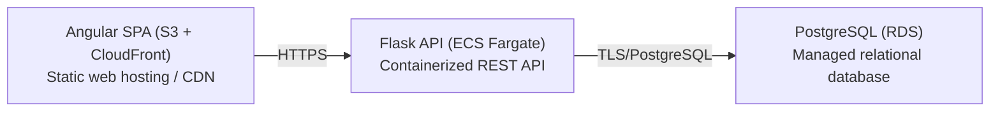

# Deployment Guide

> Maintained by QuorQ AI SDLC. Text between `sdlc:auto` markers is regenerated; anything outside them is yours and is kept.

<!-- sdlc:auto:start how-it-deploys -->
Pushes to `main` run `.github/workflows/deploy.yml`, which builds the API image (if there is a backend) and deploys the SPA to AWS Amplify. Commits touching only `docs/sdlc/**` don't deploy. Deployments can also be started from the platform's Deployment tab.
<!-- sdlc:auto:end how-it-deploys -->

<!-- sdlc:auto:start environments -->
| Name | Service | Runtime | Scaling | Environment |
|---|---|---|---|---|
| Angular SPA (S3 + CloudFront) | Static web hosting / CDN | Angular 22 build artifacts | CDN edge cache, auto | dev |
| Flask API (ECS Fargate) | Containerized REST API | Python 3.12 / Flask 3.0 under gunicorn | 1-2 tasks, modest audience | dev |
| PostgreSQL (RDS) | Managed relational database | PostgreSQL 16 | single instance (modest load) | dev |
<!-- sdlc:auto:end environments -->

<!-- sdlc:auto:start live -->
_Not deployed yet._
<!-- sdlc:auto:end live -->

<!-- sdlc:auto:start topology -->

<!-- sdlc:auto:end topology -->
